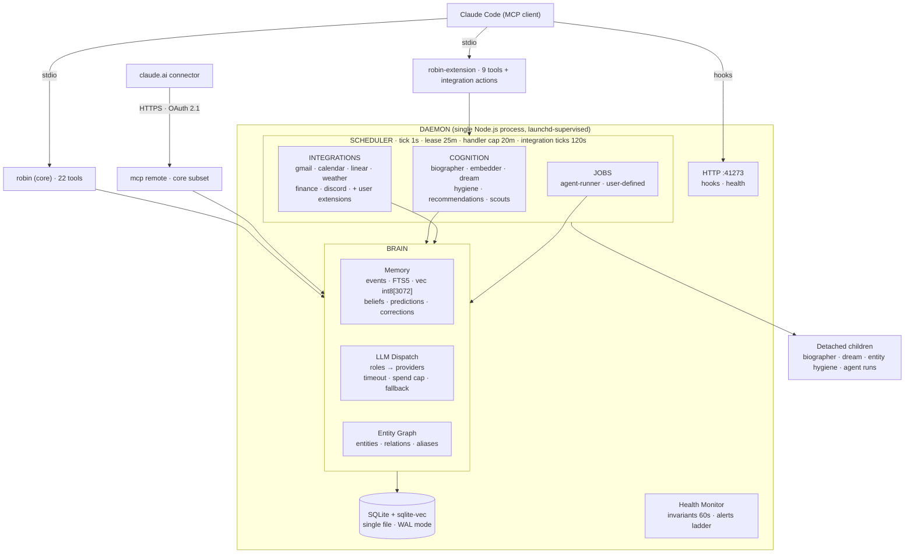

# Robin

> Local-first personal AI assistant with long-term memory, background integrations, and a skills system — driven by Claude Code via MCP.

Robin is a daemon that runs on your machine. It captures your Claude Code sessions, pulls data from your accounts (Gmail, Calendar, Linear, and any API you add an extension for), builds an entity–relation knowledge graph and a belief store in SQLite, and exposes everything as MCP servers that Claude Code talks to. After setup, Robin works in the background — you don't type `robin` commands; Claude does the driving through MCP, and Robin remembers across sessions.

## Quick start

Robin runs from a source checkout. (The `robin-assistant` package on npm is the legacy v1 and is not this codebase.)

```bash
git clone https://github.com/kevinkiklee/robin-assistant.git
cd robin-assistant
nvm use                     # Node 24 (.nvmrc)
pnpm install
pnpm build                  # tsc + extensions → dist/
pnpm robin init --yes       # one-time setup: daemon, MCP servers, Claude Code hooks, schema
```

`init` creates the `user-data/` tree, applies migrations, installs the launchd daemon (macOS), registers Robin's MCP servers in `~/.claude.json`, and installs three Claude Code hooks (session capture, session-start primer, per-prompt recall). Open Claude Code and Robin's tools (`mcp__robin__*`, `mcp__robin-extension__*`) are available. Run `robin doctor` any time to check health.

## Requirements

| Requirement | Notes |
|---|---|
| **Node 24** | Pinned via `.nvmrc`. `better-sqlite3` is a native binding; the ABI must match. |
| **macOS or Linux** | On macOS, `robin init` installs the launchd autostart. On Linux, run the daemon under systemd/runit/etc. Notifications and power auto-policies are macOS-oriented. |
| **An LLM provider** | Any mix of: the Claude Agent SDK (`claude-agent`, subscription/pool-billed), an Anthropic API key, Google for embeddings, or **Ollama** for local inference. Roles are mapped in `models.yaml` (see [LLM dispatch](#llm-dispatch)). |

`robin init` seeds an empty `models.yaml` (`roles: {}`); add your roles and secrets and you're running. Without an LLM, Robin still captures, ingests, and serves lexical recall — the model-backed steps degrade rather than fail. The vector dimension is fixed by the schema (`int8[3072]`), so your embed model must output 3072 dimensions.

## Architecture



### Three layers

```
system/        Framework: kernel (daemon + scheduler + health), brain (memory + cognition + LLM),
               agent (guarded agentic runner), integrations + jobs runtimes, surfaces
               (CLI, HTTP, MCP), skills, lib
user-data/     Per-user instance: memory, secrets, extensions, knowledge files (gitignored)
dist/          Compiled output (gitignored); pnpm build to regenerate
lab/           Offline test lab — synthetic-life replay against a sandboxed copy of the memory pipeline
```

### The daemon

A single Node.js process, supervised by launchd (macOS). It owns the scheduler, health monitor, integration lifecycle, and the HTTP hook receiver. On startup it loads secrets from `user-data/config/secrets/.env`, applies migrations, classifies the boot (clean restart vs. crash vs. system reboot), wires integrations and jobs into cron schedules, and starts the tick loop.

The **scheduler** claims one pending job per tick (1s) and re-arms cron jobs on completion — even on failure, so a transient error can't permanently silence a schedule. **Integration ticks** run inside a 120s timeout; every in-process handler also has a 20-minute wall-clock backstop so one wedged handler can't stall the loop. **LLM-scale work** — the biographer, the dream pass, entity hygiene, and agent runs — runs in **detached child processes** that own their job row, renew their own lease, and enforce their own deadline, so a slow model can't block the scheduler. A 60s lease reaper recovers jobs abandoned by crashed handlers. If the tick loop itself hangs, the health monitor escalates through a sustained-CRITICAL gate and then `exit(1)`s for launchd respawn.

### Memory

Everything Robin knows lives in a single SQLite file:

- **Events** — the raw log. Every captured session, integration tick, belief, prediction, and recommendation is an event. Facts are superseded, not edited in place. Retention compacts captured sessions older than 90 days to the operator's own turns and prunes old job rows and transcripts.
- **Search** — full-text (FTS5) and vector embeddings (`int8[3072]` via `sqlite-vec`), fused with Reciprocal Rank Fusion. `recall` runs lexical, vector, or hybrid mode, with distance floors so a weak match is dropped instead of injected. An embed policy keeps integration telemetry out of the vector index.
- **Entity graph** — people, places, tools, and services, connected by relations the biographer extracts from your conversations. A per-instance alias map and a weekly hygiene pass merge entities that are one thing under several names. Traversal is `related_entities`.

On top of the event stream, Robin keeps structured stores for reasoning:

- **Beliefs** — what Robin currently thinks is true, keyed by a canonicalized topic. A new belief supersedes the prior head for its topic; `recall_belief` returns current truth without embedding search. Extracted claims land first as **belief candidates**. The nightly dream pass promotes the ones that stay stable (7 days by default), merges near-duplicates, and flags conflicts with the current head for review. A formation gate keeps live integration readings and low-confidence claims out of the belief store.
- **Predictions** — forecasts with confidence and a deadline. Predictions with a structured resolution spec are resolved deterministically against Robin's own events; the rest are resolved through `resolve_prediction` or eventually closed as unverifiable. Brier scores track calibration.
- **Recommendations** — substantive buy/skip/try/wait stances, logged with `recommend`. A nightly linker detects whether you acted on them (including order and booking emails); a weekly pass backfills unlogged ones and judges open ones.
- **Habits** — behavioral patterns inferred from signal streams, with confidence that graduates or retires over time.
- **Corrections** — what Robin said wrong and the fix (see [the self-learning loop](#the-self-learning-loop)).

### Cognition

Background jobs do Robin's thinking:

- **Biographer** (every minute, detached) — reads captured sessions and extracts entities, relations, and claims. Works in chunks across ticks, drops harness/skill scaffolding, and only extracts personal-domain facts (engineering entity types are blocked). Failed claim extractions go to a dead-letter queue with bounded retry. If the LLM is unreachable, it aborts without advancing its cursor.
- **Embedder** (every minute) — embeds rows the ingest path left un-embedded.
- **Doc ingest** (every 10 min) — indexes `user-data/content/knowledge` and `content/profile` (`.md` and `.html`) into recall. Content-hashed and idempotent.
- **Dream** (nightly, detached) — resolves predictions, applies topic-linked corrections, rolls up metrics, refreshes stale entity profiles, clusters sessions into arcs, promotes, dedupes, and expires belief candidates, collapses duplicate belief topics, and writes a journal entry. Deterministic steps need no model; summarization steps degrade when none is available.
- **Weekly and nightly passes** — behavioral habit reinforcement and synthesis, the recommendation linker and scan, per-domain scouts that propose gated recommendations, entity hygiene, a monthly recall-quality audit, a nightly reliability audit, a daily retention sweep, and a daily `doctor` run with auto-repair.

### LLM dispatch

Robin routes each kind of work to a model by **role** (`reasoning`, `summarize`, `classify`, `embed`, …), defined in `user-data/config/models.yaml`. Providers: `claude-agent` (Claude Agent SDK), `anthropic`, `google` (embeddings only), and `ollama`. Mix freely per role:

```yaml
roles:
  reasoning:
    provider: claude-agent
    model: claude-sonnet-5-5
    fallback: { provider: claude-agent, model: claude-opus-5-5 }   # used only on a usage-limit error
  summarize: { provider: claude-agent, model: claude-opus-5-5, effort: high }
  classify:  { provider: claude-agent, model: claude-sonnet-5-5, effort: low }
  embed:     { provider: google, model: gemini-embedding-2, embedDims: 3072 }
  # all-local alternative:
  # reasoning: { provider: ollama, model: qwen3:14b }
  # embed:     { provider: ollama, model: qwen3-embedding:8b }   # must output 3072 dims
```

Every call goes through one dispatcher: wrapped in a timeout (5 min for invokes, 2 min for embeds, overridable per call) and metered against a **daily USD spend cap** for metered API providers (`ROBIN_LLM_DAILY_USD_CAP`, default $10 when any cloud API provider is configured). The cap throws cleanly, and callers treat it like a transient outage — no half-written results. `claude-agent` spend is subscription-billed and recorded to the usage ledger instead. Providers register leniently, so a missing secret produces a warning, not a crash. Switching embedders means `robin reindex --force`.

### Agentic execution

Plain LLM calls (`llm.invoke`) answer one question. Some work needs an **agent** — a multi-turn tool loop that explores memory, follows threads, and produces structured output. Robin runs these through one guarded primitive, `runAgent` (`system/agent/`), and bans every other path (no `claude -p` shell-outs, no ad-hoc nested sessions):

- **Ledger-accounted** — one usage row per run (tokens, cost, status, outcome).
- **Tool-allowlisted** — an explicit `allowedTools` set, never "all." Read-only runs also pass `disallowedTools` to deny the write builtins, since an allowlist alone doesn't gate built-in tools.
- **Capped** — every run is bounded by `maxTurns`, `timeoutMs`, `maxBudgetUsd`, and a per-surface daily ceiling (on-demand vs. autonomous). It returns a status (`success` / `capped` / `denied` / `timeout` / `error`) rather than throwing.
- **Isolated** — write-capable handlers run in a git worktree under a fail-closed OS sandbox (seatbelt/bubblewrap).
- **Auditable** — every run streams a JSONL transcript to `user-data/agent-runs/`.

Work is organized as **handlers** (A–L: research, KB curation, belief reconciliation, prediction calibration, gap fill, dream enrichment, health remediation, and others). Each emits a structured outcome envelope that is checked by a deterministic verifier. The `agent-runner` job dispatches one autonomous handler every 3 hours in round-robin, as a detached child. Deterministic pre-checks skip runs with nothing to do, and a handler that fails three times in a row is benched. Autonomous runs are **off by default** (`agent.enabled` in `policies.yaml`). On demand: `robin agent "<goal>"` or the `agent` tool on robin-extension.

### Claude Code hooks

`robin init` installs three hooks in `~/.claude/settings.json`, all posting to the daemon on `127.0.0.1:41273`:

- **SessionEnd** — posts the transcript path. The daemon projects the JSONL into turns, applies skip rules (out-of-scope working directory, Robin's own internal LLM calls, sessions with no real assistant work, pure-dev sessions), dedupes by content hash, and writes a `session.captured` event for the biographer. A built-in `claude_code` integration also scans transcripts every 5 minutes as a fallback.
- **SessionStart** — returns the **primer**: active corrections, current belief heads, the profile prose, and an index of knowledge docs. It is derived from stored data and needs no LLM.
- **UserPromptSubmit** — **auto-recall**. It injects the canonical docs for keyword-matched topics, then relevant recall snippets, corrections, habit hints, and open recommendations for that prompt. Every failure path degrades to injecting nothing. The same hook handles **event notes** (`>>note <slug>` … `>>end`): during a note session, prompts are appended to a raw note file and never reach the model.

For the full deep dive — database schema, scheduler internals, health and alerting, and the integration contract — see [`docs/ARCHITECTURE.md`](docs/ARCHITECTURE.md).

### Integrations

Integrations connect Robin to external data sources. Each is a directory with an `integration.yaml` manifest and an `index.ts` exporting `tick()` (plus optional `init`, `cleanup`, `health`, and MCP `actions`). The daemon runs them on their cron schedule — every 15 minutes for Gmail, 30 for Calendar and Linear, and so on.

A tick pulls data from an API, normalizes it, and calls `ingest()`, which dedupes by content hash. Each tick records a heartbeat (last attempt, last success, ingest count, consecutive errors) that the health monitor reads to detect stale or degraded streams.

**Built-in** (`system/integrations/builtin/`): `gmail` (inbox and sent), `google_calendar`, `linear` (with write actions), `weather` (Open-Meteo forecasts and sky/light alerts), `finance_quote`, `claude_code` (session capture), `notify` (macOS banners), and `discord` (outbound notifications). **User extensions** live in `user-data/extensions/integrations/`, load the same way, and hot-reload on change. That's where you add your own: a fitness tracker, a bank feed, anything with an API. Directories prefixed `_` are skipped.

`robin reauth <name>` re-authorizes an OAuth integration with a one-shot local flow: browser consent → localhost callback → new refresh token written to `.env` → daemon restarted. Google OAuth apps in testing mode expire refresh tokens after 7 days.

### Notifications

One fan-out, `notifyOperator()` (`system/lib/notify/operator.ts`), sends operational alerts — health-critical invariants, agent-paused notices, sky alerts — to a macOS banner **and** Discord in parallel. Neither transport can throw or suppress the other. Discord is outbound REST only (no gateway connection, no `discord.js`), with `notify`, `dm`, and `digest` actions. Digests split long documents into consecutive messages and rewrite markdown tables, which Discord doesn't render. Without a bot token, the Discord side no-ops quietly. Every outbound message passes a discretion check that refuses credential and PII shapes.

### Publishing

`robin publish --source <file> --slug <slug>` publishes a page to the web (Vercel Blob, served by the companion `askrobin.io` app). The default format is a standalone HTML document with inline CSS and optional sandboxed JavaScript; markdown is also supported. Local images and attachments upload automatically. Every page URL carries an HMAC hash, so URLs are unguessable but stable across republishes. Pages are `noindex` but not access-controlled. Publish refuses credential shapes, PII shapes, and booking references. `robin published` lists what's live. Details: `system/lib/publish/README.md` and [`docs/PUBLISHING.md`](docs/PUBLISHING.md).

### Skills

Skills are reusable, named methodologies — a directory with a `SKILL.md` (plus optional reference files). Robin serves skill content via the `skill` MCP tool; it never executes anything — the MCP client reads and runs bundled scripts itself.

- **System skills** (`system/skills/builtin/`): `memory-curation`, `skill-authoring`, `web-research`.
- **User skills** (`user-data/extensions/skills/`) are personal and gitignored. A user skill with the same name shadows a system skill.

### MCP servers

Two stdio servers, plus one HTTP surface:

| Server | Tools | Purpose |
|---|---|---|
| **robin** (`robin mcp core`) | `recall`, `remember`, `find_entity`, `get`, `related_entities`, `list`, `integration_status`, `predict`, `recommend`, `believe`, `recall_belief`, `review_beliefs`, `resolve_belief_candidate`, `record_correction`, `audit`, `explain`, `health`, `metrics`, `journal`, `power`, `alerts`, `skill` | Memory, cognition, self-model, health |
| **robin-extension** (`robin mcp extension`) | `run`, `integration_status`, `ingest`, `related_entities`, `resolve_prediction`, `resolve_recommendation`, `agent`, plus one tool per integration with actions (`gmail`, `google_calendar`, `linear`, `finance`, `discord`, and user extensions) | Job/integration control, integration actions, agentic runs |
| **remote** (`robin mcp remote [--port N]`) | A named subset of core: 15 read tools, plus 6 memory-ledger writes under the `robin:write` scope | Streamable HTTP at `/mcp` for claude.ai custom connectors |

The remote surface binds loopback (default port 41274); reaching it from the internet takes a deliberate tunnel. It is its own OAuth 2.1 authorization server (dynamic client registration, S256 PKCE, rotating refresh tokens), and the consent screen is gated by an access key (`ROBIN_MCP_REMOTE_TOKEN`). `ROBIN_MCP_PUBLIC_URL` must be the public origin. Tools that execute rather than record (`agent`, `run`, `ingest`) are never remote.

The MCP servers are separate processes from the daemon; each loads secrets and opens the database itself. The core server hot-reloads when `dist/` is rebuilt. `robin init` (or `robin mcp install`) registers both stdio servers in `~/.claude.json`; for a project-scoped setup, copy `.mcp.json.example` to `.mcp.json`.

### The self-learning loop

Robin improves through four feedback mechanisms:

1. **Corrections** — `record_correction` logs an error and its fix. A correction tied to a belief topic is applied in the nightly dream pass: the wrong head is retracted and the corrected value asserted. Behavioral corrections go into every session's primer. All corrections are embedded so auto-recall can surface the ones relevant to the current prompt.
2. **Beliefs** — `believe` persists a topic-keyed claim that supersedes the prior head. Candidates that conflict with a head wait for review (`review_beliefs`, or the LLM-judged `robin beliefs reconcile`).
3. **Predictions** — `predict` logs a confidence-calibrated forecast with a deadline. The dream pass resolves overdue ones and tracks Brier calibration.
4. **Recommendations** — `recommend` logs advice. The linker and weekly scan record whether it was acted on, which feeds acted-rate calibration (`robin recommendations`) and habit inference (`robin habits`).

### Configuration

All user-editable config lives in `user-data/config/`:

- `models.yaml` — LLM role → provider + model mapping
- `operator.yaml` — who you are, kept out of the public code: `name`, a short `context` paragraph for the biographer, `aliases` (handles you go by), `private_terms` (words that must never appear in tracked files; a guard test checks), and `home: { lat, lng, label, tide_station, taf_station }` for weather, tides and sky alerts. Optional; without it prompts say "the user" and location-based features skip. Restart the daemon after editing it
- `policies.yaml` — power/capture/network state, auto-policies (battery, quiet hours), alerts, biographer gating, behavior/recommendation/scout switches, and the agent block (master switch, daily caps, session defaults)
- `hardware.yaml` — detected hardware profile (written by `robin init`)
- `recall-topics.yaml` — auto-recall's keyword topic → canonical-doc map (ships empty)
- `secrets/.env` — environment-style secrets (mode 0600). Every entry point (daemon, MCP servers, scripts) loads it at startup.

The `system/` directory ships no config files — only TypeScript code.

## Development

```bash
nvm use                                     # Node 24 via .nvmrc
pnpm install
pnpm dev                                    # daemon in foreground (ROBIN_USER_DATA_DIR=./user-data)
pnpm robin <command>                        # CLI from source against ./user-data
pnpm test                                   # node --test across system/, lab/, and user-data extensions
pnpm typecheck && pnpm lint                 # tsc --noEmit + biome
pnpm exec tsx --test <file>                 # single test file
```

`pnpm build` compiles to `dist/`, which the launchd daemon and MCP servers run from. Rebuild and restart the daemon after changing `system/`. A committed pre-commit hook auto-formats staged files with Biome. `robin help --all` lists the advanced and maintenance commands: belief/entity hygiene, memory maintenance, recall debugging, `db backup|restore|vacuum`, alerts, metrics, and more.

**Test lab** (`lab/`): `pnpm lab doctor | fixture | copy | score` generates a synthetic life from a seed, replays it one sim-day at a time through a sandboxed copy of the memory pipeline (deterministic template LLM, no network, no real data), and scores the resulting beliefs against what a perfect memory could know. See [`lab/README.md`](lab/README.md).

Before contributing, read:
1. [`docs/ARCHITECTURE.md`](docs/ARCHITECTURE.md) — how Robin is built
2. [`docs/STATUS.md`](docs/STATUS.md) — current implementation snapshot
3. [`docs/BACKLOG.md`](docs/BACKLOG.md) — deferred work
4. [`docs/CONTRIBUTING.md`](docs/CONTRIBUTING.md) — workflow, code style, CI
5. [`docs/RUNBOOK.md`](docs/RUNBOOK.md) — operating and repairing a live instance

## Open-source posture

- **License:** MIT
- **Reference platform:** Apple Silicon macOS. Other hardware can run smaller local models or cloud-only.
- **Personal data** lives in `user-data/` (gitignored). For multi-machine sync, use a private companion repo containing `user-data/` minus `state/db/`.
- **Security:** report issues via GitHub private security advisories (see [`docs/SECURITY.md`](docs/SECURITY.md)). Gitleaks scans every push.

## License

[MIT](./LICENSE)
